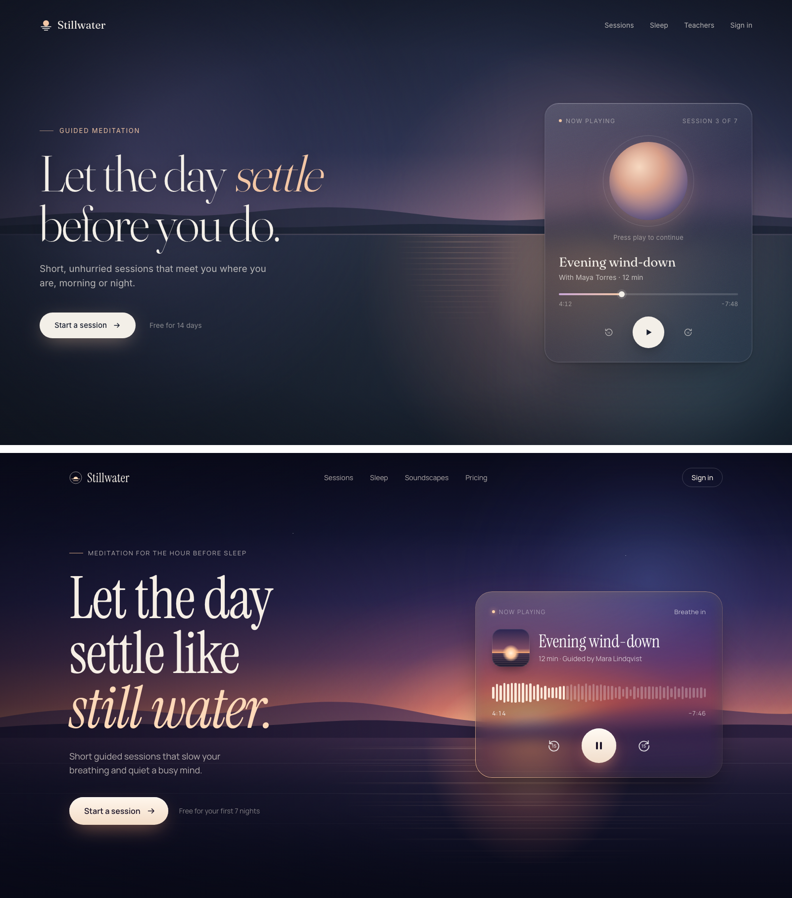
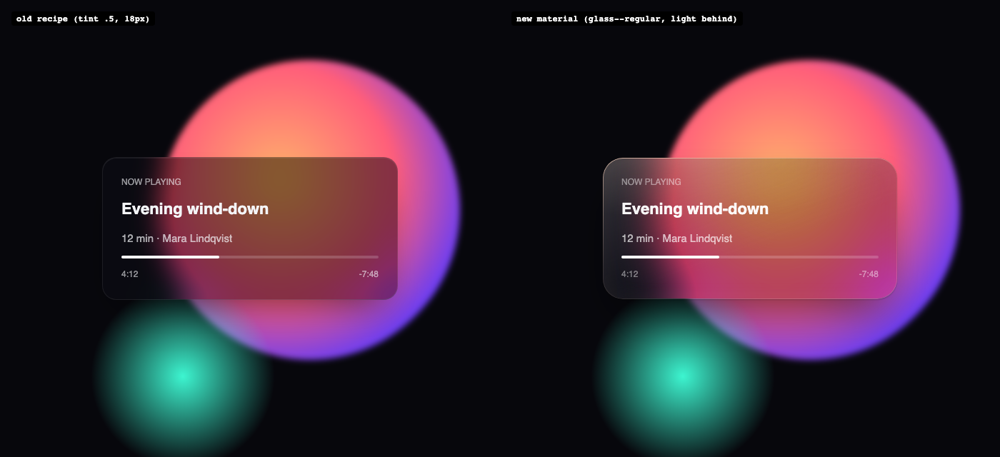
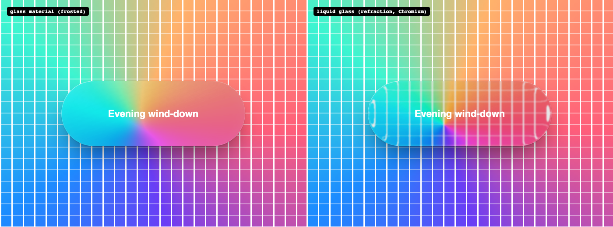
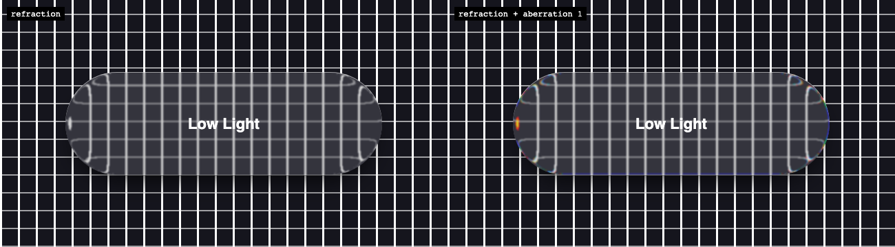
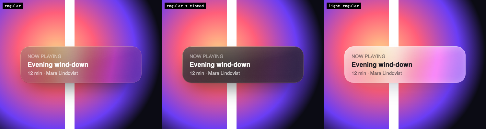
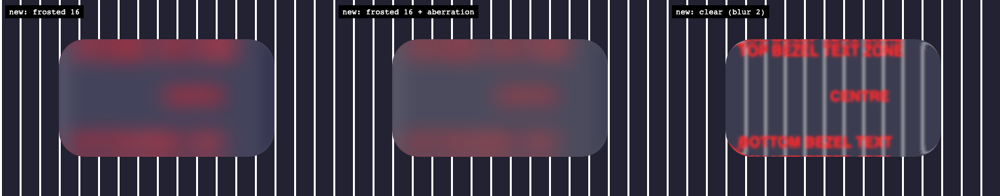
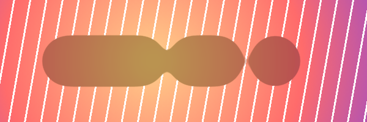

# blur-craft

An agent skill (for Claude Code, Cursor and other agents that read `SKILL.md`) that makes blur and
glass in UI look premium instead of generic.

Most glass on the web looks cheap for three reasons: nothing interesting sits behind it, the material is
one flat tint with one blur, and the text on it is a muddy grey. This skill teaches the agent the three
things Apple-grade glass gets right, gives it a drop-in material to build with, and checks the result.



**[Open the live playground](https://sridhar-raj.github.io/blur-craft/assets/demo.html)** (every surface, with thickness, tint, tone and rim controls) · **[See the A/B examples](https://sridhar-raj.github.io/blur-craft/)**

*Same brief, same model. Top: without the skill. Bottom: with it. The glass picks up the sunset behind
it, the rim glows on the sun's side, and the horizon bends through the card's lower edge.*

## Install

```bash
npx skills add sridhar-raj/blur-craft
```

Or copy this folder into `.claude/skills/blur-craft/` (Claude Code) or your agent's skills directory.

The skill triggers on its own whenever a design involves glass, frosted panels, `backdrop-filter`,
glows, depth, blur reveals, or a request to make something feel premium or "Apple-like".

## What's inside

| Path | What it is |
|---|---|
| `SKILL.md` | The method: compose the light behind the glass, build the material, choose thickness and register, five look-checks |
| `assets/glass.css` | The glass material: five layers (saturated blur, gradient fill, lit gradient rim, specular sheen, depth) plus 2.5% grain and a brightness clamp; a thickness scale (`clear`, `thin`, `regular`, `thick`, `solid`); light and dark tones; a tinted level for `prefers-contrast` (which, unlike `prefers-reduced-transparency`, reaches Safari); vibrancy text; fallbacks |
| `assets/surfaces.css` | Ready-made surfaces on the material: sticky nav (extended backdrop, optional glass-on-scroll in pure CSS), dock, menu, veil + dialog, toast, sheet |
| `assets/demo.html` | Live playground of every surface with controls; also the page the material was calibrated on |
| `assets/adaptive-tone.js` | Light/dark flip for small glass from the luminance behind it, with hysteresis (Apple's WWDC25 rule: small elements flip, panels don't) |
| `assets/glass-tier.js` | Full / lite / flat glass by device: memory, Save-Data, a frame-rate probe (iOS Low Power Mode caps at 30fps) and Compute Pressure |
| `assets/Glass.tsx` | React + Framer Motion wrapper with a sheen that follows the pointer and an optional `liquid` prop |
| `assets/liquid-glass.ts` / `.js` | Liquid Glass edge refraction (SVG displacement map through `backdrop-filter`, Chromium) with optional chromatic aberration; `watchLiquidGlass()` keeps it in step with size and cleans up; off on lite/flat tiers; frosted fallback elsewhere |
| `references/recipes.md` | Code for light-behind-glass, extended-backdrop sticky bars, progressive blur, focus veils, blur reveals, blur-bridged crossfades, glows, depth of field, motion blur, ambient art backdrops, locked content, grain |
| `references/research.md` | The sources behind every number, and what an earlier version got wrong |
| `references/quirks.md` | Browser traps: the backdrop root, Safari prefixes, clipped glows, banding, WebGL, video capture |
| `scripts/glass-contrast.mjs` | Worst-case contrast for every line of text on glass, in three states (normal, blur off as in Low Power Mode, prefers-contrast: more) |
| `scripts/blur-audit.mjs` | Audit for CSS, TSX and HTML files, plus `--url` for a live check of blurred area and frame rate (uses Playwright if the project has it) |













## How it was built

An earlier version of this skill lost a blind A/B test to a model with no skill at all: it capped blur,
used a flat tint and put performance first, so its glass came out flatter. It was rewritten from
research and re-tested until the skill version won:

- [Apple Human Interface Guidelines: Materials](https://developer.apple.com/design/human-interface-guidelines/materials)
- [Josh W. Comeau: Next-level frosted glass with backdrop-filter](https://www.joshwcomeau.com/css/backdrop-filter/)
- [Nielsen Norman Group: Glassmorphism](https://www.nngroup.com/articles/glassmorphism/)
- [kube.io: Liquid Glass in the browser](https://kube.io/blog/liquid-glass-css-svg)
- [Apple WWDC25: Meet Liquid Glass](https://developer.apple.com/videos/play/wwdc2025/219/) and [Get to know the new design system](https://developer.apple.com/videos/play/wwdc2025/356/)
- [Emil Kowalski: design engineering skills](https://github.com/emilkowalski/skills)
- Radix Themes, Primer, Polaris, Carbon and Atlassian tokens; Lea Verou's contrast-color threshold; Harrison & Vicente, CHI '96 (text over transparent menus)
- [Microsoft WinUI Acrylic source](https://github.com/microsoft/microsoft-ui-xaml/tree/main/controls/dev/Materials/Acrylic) (blur 30, 2% noise, the luminosity layer)
- The production CSS of Apple.com, Linear and Raycast (nav bars, menus, panels), read for calibrated presets
- [NN/g: Liquid Glass Is Cracked](https://www.nngroup.com/articles/liquid-glass/) and Apple's iOS 26.1 Clear/Tinted fix
- [CSS Filter Effects 2 spec](https://drafts.csswg.org/filter-effects-2/), [rdev/liquid-glass-react](https://github.com/rdev/liquid-glass-react) (chromatic aberration), WebKit bugs 245510 and 279115

**Live examples:** [sridhar-raj.github.io/blur-craft](https://sridhar-raj.github.io/blur-craft/) shows five
briefs (a meditation hero, a music app, a banking dashboard, a hotel booking page, a photo editor), each built with and without the skill, side by
side and interactive. Open in Chrome to see the refraction.

## Important: Safari on macOS Sonoma

Safari 18 and 26 on macOS Sonoma render **no blur** when `backdrop-filter` is built from CSS variables
(WebKit bug 297620, open), and Tailwind v4's `backdrop-blur-*` is built that way. This skill writes literal
filters, unprefixed first and `-webkit-` last (the bug report also shows the unprefixed property failing there), and its audit flags both problems.

## Quick start without an agent

```html
<link rel="stylesheet" href="assets/glass.css">
<link rel="stylesheet" href="assets/surfaces.css">

<div class="glass glass--regular" style="--glass-light: 255 200 160; --glass-rim-angle: 45deg">
  <p class="glass-tertiary">Now playing</p>
  <h3 class="glass-label">Evening wind-down</h3>
  <p class="glass-secondary">12 min · Guided</p>
</div>
```

Put a light source (a glow, an image, a WebGL background) half under the glass. That matters more than
any value in the CSS.

## License

MIT
