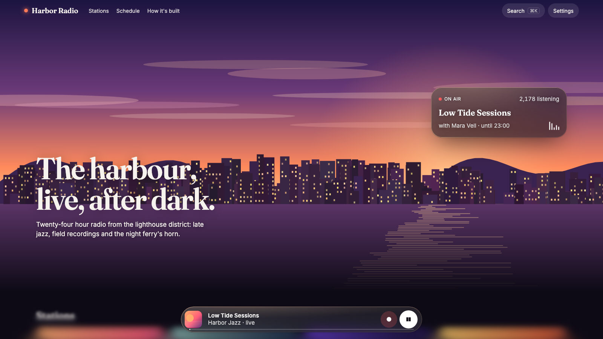
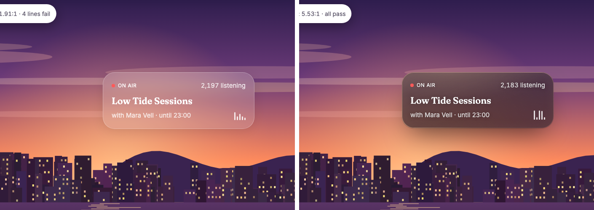

# blur-craft

An agent skill (for Claude Code, Cursor and other agents that read `SKILL.md`) that makes blur and glass
in UI look premium **and proves it's readable**.

Most glass on the web looks cheap for three reasons: nothing interesting sits behind it, the material is
one flat tint with one blur, and nobody measured the text on it. This skill gives the agent a method
(compose the light, choose the thickness, avoid the traps), a measured drop-in material, ready-made
surfaces, and scripts that check the result.



**Before / after, one link:** [sridhar-raj.github.io/blur-craft](https://sridhar-raj.github.io/blur-craft/)
opens the example twice with a before/after slider: move across the page and the line follows, typical glass on
the left, blur-craft on the right, scrolling together. The example itself also has a switch at the top. *Before* swaps the glass for the typical
tutorial recipe (flat 15% white, 16px blur, white border); *After* is blur-craft. Same page, same words:



| Mode | Worst contrast (desktop) | Lines failing | Phone |
|---|---|---|---|
| [Before (typical glass)](https://sridhar-raj.github.io/blur-craft/?mode=before) | 1.91:1 | 4 | 4.38:1, 1 fails |
| [After (blur-craft)](https://sridhar-raj.github.io/blur-craft/?mode=after) | 5.53:1 | 0 | 5.47:1, 0 fail |

**[Open the live example](https://sridhar-raj.github.io/blur-craft/)**: Harbor Radio, one working product
with every glass use case in its real place: a nav that turns to glass on scroll, an on-air card over the
sun with live listener counts, a Liquid Glass player dock, progressive blur under it, a ⌘K search palette,
a recording dialog, toasts and settings with a tinted-glass switch and a measured device tier. All of it
passes the skill's own contrast check (every line, three states, desktop and phone).

Also: **[the playground](https://sridhar-raj.github.io/blur-craft/assets/demo.html)** (every surface
with thickness, tint, tone and rim controls) and **[the browser check](https://sridhar-raj.github.io/blur-craft/assets/browser-check.html)**: the
Tabula hero from the OriginKit posts behind the same before/after slider (a typical Tailwind-style glass build vs blur-craft, in
whatever browser you open it in); ten surfaces each written a different way with a per-browser table; a
second real use case (the Esquisse sign-in over a landscape: typical glass 1.69:1 with 7 of 12 lines failing,
blur-craft 4.97:1 with all passing, still see-through); and a with-and-without table of what the skill changes.
On Safari for macOS Sonoma the typical side is expected to lose its blur; blur-craft's keeps it.

## Install

```bash
npx skills add sridhar-raj/blur-craft
```

Or copy this folder into `.claude/skills/blur-craft/` (Claude Code) or your agent's skills directory. The
skill triggers on its own whenever a design involves glass, frosted panels, `backdrop-filter`, glows,
depth, blur reveals, or a request to make something feel premium or "Apple-like".

## What makes it different

- **It measures.** `glass-contrast.mjs` checks every line of text on glass at its worst pixel in three
  states (normal, blur off as in iOS Low Power Mode, high contrast). `frost-check.mjs` checks every
  surface actually blurs. Both caught failures that looked fine by eye, including in this repo's own
  example while it was being built.
- **It knows the traps:** Safari on macOS Sonoma dropping blur built from `var()` (Tailwind's included),
  parent fades and view transitions flattening glass, Chromium leaving the Liquid Glass rim unblurred,
  screenshot and PDF tools dropping the blur.
- **It's complete:** a calibrated material with five thicknesses and a tinted level; device tiers; forced
  colors, print, capture mode and RTL; React, Vue and Svelte components; a Tailwind v4 file; a native
  (SwiftUI, Flutter, React Native, Compose) reference.
- **It's built on primary sources**, and corrected when they disagreed with it (see
  `references/research.md`).

## What's inside

| Path | What it is |
|---|---|
| `SKILL.md` | The method, the quick path ("I'm building X → use Y") and the required checks |
| `assets/glass.css` | The material: saturated blur, gradient fill, lit rim, specular sheen, depth, 2.5% grain and a brightness clamp; `clear`/`thin`/`regular`/`thick`/`solid`; light tone; tinted level (`prefers-contrast`, which reaches Safari); neutral glass; device tiers; forced colors, print, capture, RTL. Literal filters throughout (Sonoma-safe) |
| `assets/surfaces.css` | Sticky nav (extended backdrop, glass-on-scroll in pure CSS), dock, menu, veil + dialog, toast, sheet |
| `assets/Glass.tsx`, `Glass.vue`, `Glass.svelte` | Components for React (Framer Motion), Vue 3 and Svelte 5: thickness, tone, tint, an opt-in pointer sheen for interactive glass only, and Liquid Glass |
| `assets/glass.tailwind.css` | Tailwind v4 utilities that compile to literal filters (`glass-blur-24`, …); Tailwind's own `backdrop-blur-*` breaks on Sonoma Safari |
| `assets/liquid-glass.ts` / `.js` | Liquid Glass refraction of any page content (Chromium) with chromatic aberration; `watchLiquidGlass()` keeps it in step with size and cleans up |
| `assets/liquid-glass-webgl.js` | Liquid Glass in **every** browser (Chrome, Safari, Firefox) over a canvas, image or video backdrop, via WebGL |
| `assets/glass-tier.js` | Full / lite / flat glass by device (memory, Save-Data, frame-rate probe, Compute Pressure) |
| `assets/adaptive-tone.js` | Light/dark flip for small glass from the luminance behind it |
| `assets/demo.html`, `assets/browser-check.html` | The playground and the cross-browser check |
| `scripts/glass-contrast.mjs` | Worst-case contrast for every line of text on glass, three states |
| `scripts/frost-check.mjs` | Does each surface actually blur (blur on vs off) |
| `scripts/blur-audit.mjs` | Static audit (CSS, TSX, Vue, Svelte, HTML) and a live `--url` check |
| `references/` | `recipes.md` (every effect, with code), `quirks.md` (browser and performance traps, support table), `native.md`, `research.md` (sources) |

## Important: Safari on macOS Sonoma

Safari 18 and 26 on macOS Sonoma render **no blur** when `backdrop-filter` is built from CSS variables
(WebKit bug 297620, open), and Tailwind v4's `backdrop-blur-*` is built that way. This skill writes literal
filters, unprefixed first and `-webkit-` last, and its audit flags both problems.

## Quick start without an agent

```html
<link rel="stylesheet" href="assets/glass.css">

<div class="glass glass--regular" style="--glass-light: 255 200 160; --glass-rim-angle: 45deg">
  <p class="glass-secondary">Now playing</p>
  <h3 class="glass-label">Evening wind-down</h3>
</div>
```

Put a light source (a glow, an image, a WebGL background) half under the glass, then run
`node scripts/glass-contrast.mjs your-page.html`.

## License

MIT
